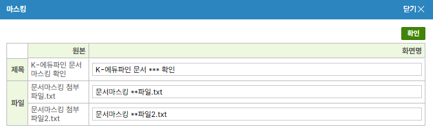
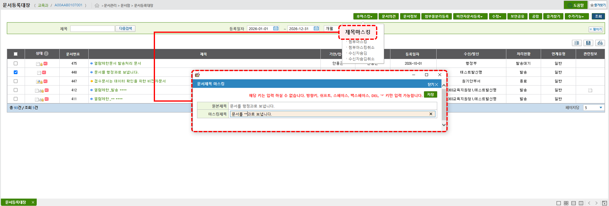

# 마스킹

개인정보나 민감정보의 노출을 줄이기 위해 **문서관리카드 작성 시 `마스킹` 기능을 사용할 수 있습니다.** 문서관리카드 상단의 `마스킹` 버튼을 클릭하여 처리하며, 이 기능은 교육청 총괄운영자가 활성화한 경우에만 사용할 수 있습니다. 최종결재 이후의 생산문서와 접수 이후의 접수문서는 문서등록대장의 `후마스킹` 기능으로 마스킹합니다.

<figure markdown="span">
  
</figure>

## 기능안내

- 마스킹 처리된 문서는 **문서를 열기 전 노출되는 영역에서는 마스킹된 제목이 표시**되며, 문서를 열면 원본이 출력됨
- **제목, 첨부파일명에 대해 설정할 수 있으며** 작성자가 마스킹하려는 단어에 직접 `*`을 입력해 변경
- 결재 처리 과정에서도 동일한 방법으로 마스킹 적용 가능하며, 결재선 내 협조자를 제외한 모든 사용자가 적용 가능
- 마스킹이 적용된 경우 문서를 열람하면 `"문서제목/첨부파일명에 마스킹이 설정되어 있습니다."` 안내 팝업이 표시됨
- 마스킹 시에는 **방향키, Shift, Space, Backspace, Del, `*`만 입력 가능**
- 결재 전 수행한 마스킹은 이후 **취소하거나 변경할 수 없음**, 문서등록대장에서 수행한 후마스킹은 처리과문서담당자가 취소 가능
- 마스킹 처리된 문서는 **정보공개포털에는 마스킹된 상태로 공개**되고, 기록물 이관 시에는 원본 문서가 이관됨

!!! Info "문서등록대장 `후마스킹` 처리 안내"
    <figure markdown="span">
        
    </figure>

    - 문서등록대장에서 문서를 선택한 후 상단의 `후마스킹` 버튼 클릭
    - 문서등록대장에 조회되는 문서(문서번호가 채번된 문서)에 사용 가능
        - 생산문서 : 최종결재완료 시 문서번호 채번
        - 접수문서 : 접수 시 문서번호 채번
    - 당해연도 기준은 생산문서는 최종결재완료일, 접수문서는 접수일
    - 생산문서(발송문서 포함)는 당해연도 문서에 한해 기안자만 처리 가능하며, 제목·첨부파일 제목·수기로 작성한 수신처에 대해 마스킹 가능
    - 접수문서는 유통으로 받은 접수문서만 제목 후마스킹 가능하며, 접수자만 처리 가능
    - 후마스킹 처리 내역은 DB에 기록되며, 내부메일 발송 여부는 시도 문서환경설정의 '문서등록대장 마스킹 메일 설정'에서 처리과문서담당자, 결재선 체크 여부에 따라 다름
    - **처리과문서담당자만 후마스킹 취소 가능**하며, 취소 시 최종 결재 버전의 제목으로 복원

!!! Info "발송문서 후마스킹의 수신처 적용"
    - 발신기관이 발송문서(원본)를 후마스킹하면 대내 수신처의 접수문서에 일괄 자동 적용됨(별도 선택 옵션 없음)
    - 유통 수신처에는 적용되지 않음. 수신처가 모두 유통 수신처인 경우에도 발신기관의 원본문서는 후마스킹 가능
    - 수신처의 접수문서에는 대국민공개여부, 직원열람범위 등의 제약 없이 적용됨
    - 수신처에서는 취소할 수 없으며, 발신기관이 원본문서의 후마스킹을 취소해야 수신처에도 반영됨
    - 수신처 담당자에게는 내부메일이 발송되지 않음
    - 대내로 받은 접수문서는 수신처에서 직접 마스킹할 수 없음

## 제약사항

아래 조건에 하나라도 해당되는 문서의 경우 마스킹, 후마스킹 기능이 적용되지 않습니다.

=== "마스킹(문서관리카드)"

    - 대국민공개여부 : 공개, 부분공개, 비공개(5호)
    - 직원열람범위 : 부서
    - 발송문서(후마스킹으로만 처리 가능)
    - 접수문서
    - 공동기안
    - 비전자문서(생산, 접수)
    - 당해연도 이전 생산문서

=== "후마스킹(문서등록대장)"

    - 대국민공개여부 : 공개, 부분공개, 비공개(5호)
    - 직원열람범위 : 부서
    - 유통으로 받은 접수문서를 제외한 접수문서
    - 공동기안
    - 비전자문서(생산, 접수)
    - 당해연도 이전 문서(생산문서는 최종결재완료일, 접수문서는 접수일 기준)

    발신기관의 후마스킹이 수신처의 접수문서에 자동 적용되는 경우에는 대국민공개여부, 직원열람범위 등의 제약이 적용되지 않습니다.
